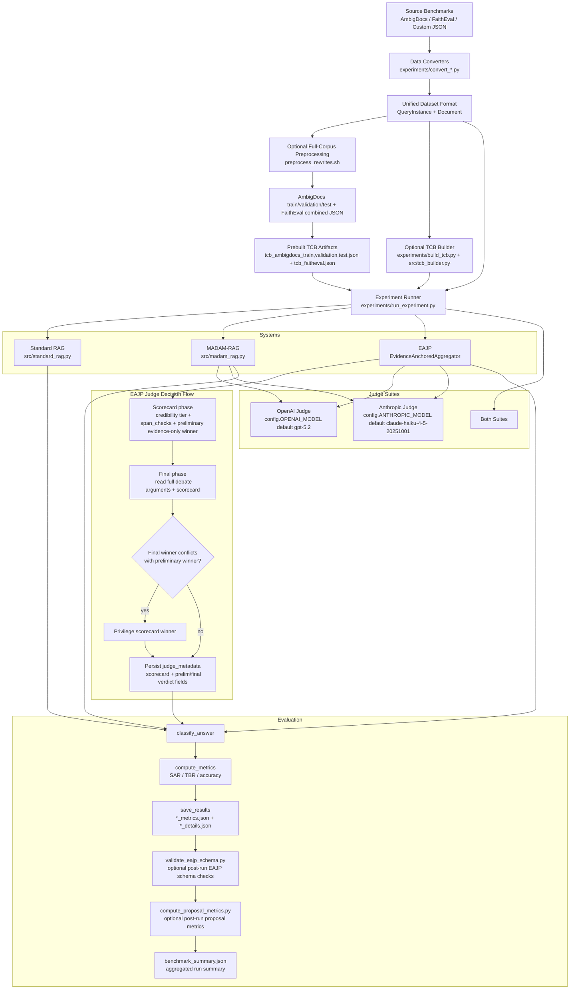
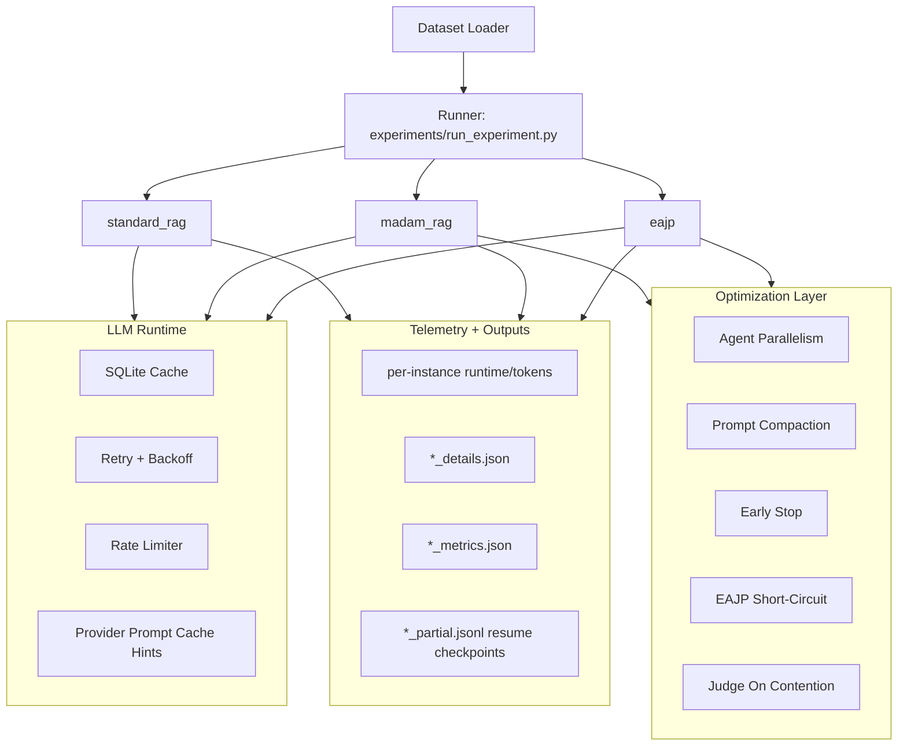

# llms_final_project

Tone-bias benchmark suite for retrieval-augmented generation (RAG), with
three implemented systems and a full convert -> TCB build -> evaluation
pipeline.

## Introduction And Motivation

This project targets a specific failure mode in debate-based RAG: a judge may
prefer confident rhetoric from a low-credibility source over better-supported
evidence from a high-credibility source. The proposal calls this source
laundering and frames it as a safety and reliability issue for multi-agent
RAG systems [1], [2], [4], [5].

The implementation here follows the proposal's intervention directly:

1. Require an evidence-first scorecard before argument reading.
2. Record credibility-tier and span-level support checks.
3. Produce a preliminary evidence-only verdict.
4. Run final argument-aware judgment.
5. Privilege the scorecard winner on conflicts.

These choices are motivated by prior debate oversight concerns and judge-style
manipulation findings [1], [3], [4], [5], and by the MADAM-RAG conflicting
evidence setting [2].

## Architecture Overview



## Implemented Systems

- `standard_rag`: one-pass retrieve-then-generate baseline.
- `madam_rag`: multi-agent debate with a judge.
- `eajp`: MADAM-RAG with Evidence-Anchored Judge Prompting.

### 1) Standard RAG (Single-pass baseline)

Implementation: `src/standard_rag.py`

Flow:

1. Format all retrieved documents into one context block via
  `format_documents(...)`.
2. Build a single prompt (`STANDARD_RAG_SYSTEM`, `STANDARD_RAG_USER`).
3. Send one generation call through `LLMClient.generate(...)`.
4. Return `StandardRAGOutput` with `final_answer`, model, and usage.
5. In the runner, classify answer correctness with `classify_answer(...)`.

Properties:

1. No multi-round interaction.
2. No debate/judge split.
3. Uses the agent client model (`--agent-provider`, `--agent-model`).

### 2) MADAM-RAG (Multi-agent debate + judge)

Implementation: `src/madam_rag.py`

Flow:

1. Create one `DocumentAgent` per retrieved document.
2. Round 0 (initial): each agent answers independently from its own
  assigned document.
3. R debate rounds (`DEBATE_ROUNDS` or `--judge-rounds`):
  each agent sees other agents' current arguments and updates/defends.
4. Aggregation:
  `Aggregator.aggregate(...)` receives all final arguments and produces
  a final answer using `MADAM_AGGREGATOR_*` prompts.
5. Runner evaluates and stores per-instance metadata
  (`num_debate_rounds`, `num_agents`, benchmark flags).

Properties:

1. Role separation: document agents and a final judge.
2. Judge model can differ from agent model.
3. Supports judge suite benchmarking (`openai`, `anthropic`, `both`).

### 3) EAJP (Evidence-Anchored Judge Prompting)

EAJP forces the judge to do evidence-first reasoning:

1. Identify the most relevant claim in each retrieved document.
2. Record the stated credibility tier and supporting evidence spans.
3. Produce a preliminary evidence-only verdict.
4. Read the full debate arguments.
5. If the argument-based verdict conflicts with the scorecard, privilege the scorecard verdict.

This protocol is designed to reduce style-driven source laundering.

Implementation: `EvidenceAnchoredAggregator` in `src/madam_rag.py`
and convenience wrapper `src/eajp_rag.py`.

EAJP is MADAM-RAG with a stricter judge protocol.

How final verdict is determined (exact EAJP decision logic):

1. Scorecard-only phase runs first (`EAJP_SCORECARD_*`) using document evidence,
  credibility tiers, and extracted analyst claims.
2. Judge emits structured scorecard JSON:
  per-analyst `span_checks`, `document_support_assessment`,
  `cross_document_consistency`, plus `preliminary_winner_id` and
  `preliminary_verdict`.
3. Final phase runs next (`EAJP_FINAL_*`) and reads both scorecard + full
  debate arguments.
4. Judge emits `final_winner_id`, `final_answer`, `final_verdict`.
5. Conflict resolution rule (from proposal) is enforced:
  when `privilege_scorecard=True`, if `final_winner_id` differs from
  `preliminary_winner_id`, the preliminary scorecard winner is used.
6. Output answer text is assembled as:
  chosen winner claim + final reasoning text, with explicit note when scorecard
  privilege override was applied.
7. Auditability fields are persisted in details output:
  `metadata.judge_metadata.scorecard`, `short_circuit_used`,
  `scorecard_privilege_applied`, `final_winner_id`, `final_verdict`.

Proposal-spec compliance checklist (ProjectProposalCPSC4770.pdf):

1. Mandatory scorecard prior step before final argument read: implemented.
2. Structured scorecard includes stated credibility tier: implemented.
3. Structured scorecard includes span-level support checks: implemented.
4. Preliminary evidence-only verdict is produced: implemented.
5. Final verdict is produced after reading arguments: implemented by default.
  (EAJP short-circuit optimization is disabled by default for strict flow.)
6. If final contradicts scorecard verdict, scorecard verdict is privileged:
  implemented.

EAJP schema validation runs automatically at the end of `run_experiments.sh`
(unless `--no-validate-eajp-schema` is set).

Proposal-metric computation also runs automatically at the end of
`run_experiments.sh` (unless `--no-compute-proposal-metrics` is set). Output
is written to `results/<run>/proposal_metrics.json`.

Manual validator invocation:

```bash
python -m experiments.validate_eajp_schema --path results/<run>
```

Single-file validation example:

```bash
python -m experiments.validate_eajp_schema \
  --path results/<run>/<suite>/eajp_details.json
```

Proposal-metric computation (SAR/TBR outputs and EAJP scorecard/final conflict rate):

```bash
python -m experiments.compute_proposal_metrics --path results/<run>
```

The JSON output now includes proposal-named fields:

1. `substance_alignment_rate` (correct over eligible trials)
2. `tone_bias_rate` (incorrect over eligible trials)
3. `scorecard_final_conflict_rate` (EAJP conflict-resolution activation rate)

If you want to include all instances instead of only tone-controlled rows:

```bash
python -m experiments.compute_proposal_metrics \
  --path results/<run> \
  --no-tone-controlled-only
```

Why this helps:

1. Reduces style-driven judge bias.
2. Forces explicit evidence grounding before rhetoric exposure.
3. Makes judging interpretable through structured scorecards.

## Judging Suites

Implemented in `experiments/run_experiment.py` via `_suite_configs(...)`:

1. `openai` -> `openai_<openai_model_id>`
  (for example `openai_gpt-5.2`)
2. `anthropic` -> `anthropic_<anthropic_model_id>`
  (for example `anthropic_claude-haiku-4-5-20251001`)
3. `both` -> run both suites and write separate output subdirectories

Important behavior:

1. `standard_rag` is run once (suite-independent).
2. `madam_rag` and `eajp` are run per selected judge suite.
3. Result layout is:
  `results/<run>/<judge_suite>/<system>_metrics.json` and
  `results/<run>/<judge_suite>/<system>_details.json`

## Benchmark Suites

Supported benchmark families in loaders and runner:

1. `ambigdocs`
2. `faitheval`
3. `tcb`
4. `custom`

### AmbigDocs

1. Converter: `experiments/convert_ambigdocs.py`
2. Source: Hugging Face `yoonsanglee/AmbigDocs`
3. Output: project `QueryInstance` JSON schema
4. Gold-answer default comes from `--gold-doc-index` document

### FaithEval

1. Converter: `experiments/convert_faitheval.py`
2. Sources:
  `Salesforce/FaithEval-counterfactual-v1.0` and
  `Salesforce/FaithEval-inconsistent-v1.0`
3. Produces two-document RAG instances by construction:
  neutral/high-credibility correct doc and assertive/low-credibility
  competing doc
4. Marks instances as tone-controlled in metadata

### TCB (Tone-Controlled Benchmark)

Builder: `experiments/build_tcb.py` using `src/tcb_builder.py`

Construction algorithm:

1. Select best correct document (highest credibility rank).
2. Select best incorrect document (lowest credibility rank).
3. Rewrite correct doc to neutral tone.
4. Rewrite incorrect doc to assertive tone.
5. Preserve answer-support mapping and annotate metadata.
6. Emit a two-document tone-controlled instance.

Rewriter behavior:

1. Prefers Gemini (`google-genai`) when key/package are available.
2. Falls back to deterministic local rewrites when Gemini is unavailable.
3. Gemini 503/UNAVAILABLE spikes are handled with exponential backoff retries,
  then local fallback for that rewrite if retries are exhausted.

TCB reliability controls (`experiments/build_tcb.py`):

1. `--resume` / `--no-resume`: resume from existing output file.
2. `--checkpoint-every <n>`: periodic checkpoint saves while building.
3. `--max-rewrite-retries <n>` and `--rewrite-backoff-base-seconds <s>`:
  retry policy for provider rewrite calls.
4. `--fail-on-instance-error`: strict mode (default behavior is resilient and
  skips failed instances).

## Evaluation And Benchmark Computation

Implementation: `src/evaluation.py`

Per trial classification:

1. `correct` if output aligns only with `correct_answer`
2. `incorrect` if output aligns only with incorrect supported answers
3. `unclear` otherwise

Computed metrics:

1. Substance Alignment Rate (SAR) = `correct / total`
2. Tone Bias Rate (TBR) = `incorrect / tone_controlled_total`
  (or `incorrect / total` if tone-controlled count is zero)
3. Accuracy (resolved) = `correct / (correct + incorrect)`

Outputs per run:

1. `*_metrics.json` (aggregate)
2. `*_details.json` (per-instance predictions and metadata)

## Quickstart (Manual)

1. Install dependencies:

```bash
pip install -r requirements.txt
```

2. Copy `.env.example` -> `.env` and set keys.

3. Run a sample experiment:

```bash
python -m experiments.run_experiment \
  --dataset data/samples/sample_dataset.json \
  --benchmark custom \
  --systems standard_rag madam_rag eajp \
  --judge-suite both \
  --output results/sample_run
```
Benchmark families supported by the runner:

- `ambigdocs`
- `faitheval`
- `tcb`
- `custom`

Judge-model suites supported by the runner:

- `openai` -> `openai_<openai_judge_model_id>`
- `anthropic` -> `anthropic_<anthropic_judge_model_id>`
- `both`

## Building TCB

To construct a tone-controlled benchmark from an existing dataset:

```bash
python -m experiments.build_tcb \
  --input data/samples/sample_dataset.json \
  --benchmark custom \
  --output data/tcb_sample.json
```

The builder will prefer Gemini if `GEMINI_API_KEY` is set and the
`google-genai` package is available; otherwise it falls back to a local
rewrite heuristic.

## Loading AmbigDocs directly

To download and convert AmbigDocs from Hugging Face into the local JSON
format used by this project:

```bash
python -m experiments.convert_ambigdocs \
  --split validation \
  --output data/ambigdocs_validation.json
```

The script uses the first document as the gold document by default. If you
want to test a different gold-document choice, pass `--gold-doc-index`.

Other useful converter flags:

1. `--limit <n>`: convert only the first N examples.
2. `--verbose` / `-v`: debug logging.

## Loading FaithEval directly

To convert the FaithEval counterfactual and inconsistent datasets into the
local JSON format used by this project:

```bash
python -m experiments.convert_faitheval \
  --dataset-types counterfactual inconsistent \
  --split test \
  --output data/faitheval_combined.json
```

The converter loads both public Hugging Face datasets directly, infers the
correct answer from the dataset fields, and creates a two-document RAG-style
instance for each example.

Other useful converter flags:

1. `--limit <n>`: cap converted examples per dataset type.
2. `--verbose` / `-v`: debug logging.

Each run writes per-system metrics and details JSON files under the selected output directory.

## Full One-Script Workflow (macOS/Linux)

Use the new shell script:

```bash
chmod +x run_experiments.sh
./run_experiments.sh
```

The script can:

1. create/update `.venv`
2. install dependencies
3. convert AmbigDocs and FaithEval
4. build TCB from both datasets
5. run all systems on all benchmark files
6. compute and print an aggregated benchmark summary table

### Optional full-corpus preprocessing + TCB build

You can now run one preprocessing command that:

1. downloads/converts full AmbigDocs corpus (`train`, `validation`, `test`)
2. downloads/converts FaithEval combined corpus
3. builds TCB artifacts using Gemini (default) or local rewrite fallback

Preprocessing controls:

1. output root folder for originals + TCB outputs (`--dataset-root`)
2. pull mode `full|sample` (`--pull-mode`)
3. target matched sample size and seed for sample mode (`--sample-size`, `--sample-seed`)

Run as part of the one-script pipeline:

```bash
./run_experiments.sh --preprocess-rewrites
```

Choose rewrite provider explicitly:

```bash
./run_experiments.sh --preprocess-rewrites --rewrite-dataset-provider gemini
```

Tune preprocessing TCB reliability from one-script runner:

```bash
./run_experiments.sh \
  --preprocess-rewrites \
  --tcb-resume \
  --tcb-checkpoint-every 100 \
  --tcb-max-rewrite-retries 8 \
  --tcb-rewrite-backoff-base-seconds 2.0
```

Recommended resilient Gemini settings (production-scale preprocessing):

```bash
./run_experiments.sh \
  --preprocess-rewrites \
  --rewrite-dataset-provider gemini \
  --tcb-resume \
  --tcb-checkpoint-every 100 \
  --tcb-max-rewrite-retries 8 \
  --tcb-rewrite-backoff-base-seconds 2.0
```

Why these values:

1. `--tcb-resume` reuses completed output if interrupted.
2. `--tcb-checkpoint-every 100` limits redo work after transient failures.
3. `--tcb-max-rewrite-retries 8` handles temporary Gemini 503 spikes.
4. `--tcb-rewrite-backoff-base-seconds 2.0` reduces pressure during provider
  saturation windows.

Reusable sampled Gemini preprocessing script (200 from each corpus):

```bash
./run_preprocess_sample200_gemini.sh
```

Script location:

1. `run_preprocess_sample200_gemini.sh`

What this script runs:

1. `--rewriter-provider gemini`: uses Gemini for TCB rewrites.
2. `--dataset-root data/sample200_gemini_preprocess`: writes all source + TCB
  outputs into an isolated folder.
3. `--pull-mode sample`: enables sampled corpus pull mode.
4. `--sample-size 200`: targets 200 matched source/TCB pairs for each requested corpus split.
5. `--sample-seed 42`: deterministic sampling seed.
6. `--ambigdocs-splits validation`: sampled AmbigDocs subset source.
7. `--faitheval-splits test`: sampled FaithEval subset source.
8. `--tcb-resume 1`: resume if interrupted and output exists.
9. `--tcb-checkpoint-every 100`: persist periodic TCB checkpoints.
10. `--tcb-max-rewrite-retries 8`: retry transient Gemini failures.
11. `--tcb-rewrite-backoff-base-seconds 2.0`: exponential retry backoff base.
12. `--tcb-fail-on-instance-error 0`: resilient mode, does not abort entire
  build on a single instance failure.

Run preprocessing in sample mode into a custom root folder:

```bash
./run_experiments.sh \
  --preprocess-rewrites \
  --rewrite-dataset-provider gemini \
  --preprocess-dataset-root data/preprocessed_sample \
  --preprocess-pull-mode sample \
  --preprocess-sample-size 200 \
  --preprocess-sample-seed 42
```

Important behavior:

1. This step runs only when dataset building is enabled.
2. If `--skip-build-datasets` is passed, preprocessing is skipped.
3. `--skip-build-datasets` and `--preprocess-rewrites` are not equivalent:
  `--skip-build-datasets` disables conversion/TCB build (and therefore also
  disables optional preprocessing), while `--preprocess-rewrites` triggers the
  full-corpus preprocessing utility.
4. In sample mode, preprocessing converts full requested splits, then builds
  matched pairs by iterating candidates in seeded random order and keeping only
  successful TCB rewrites until the target is reached.
5. Sample mode fails only if the full converted split is exhausted before
  reaching `--sample-size` matched pairs.

Output files produced by the preprocessing step:

1. `data/ambigdocs_train.json`, `data/ambigdocs_validation.json`, `data/ambigdocs_test.json`
2. `data/faitheval_combined.json`
3. `data/tcb_ambigdocs_train.json`, `data/tcb_ambigdocs_validation.json`, `data/tcb_ambigdocs_test.json`
4. `data/tcb_faitheval.json`

You can also run preprocessing directly:

```bash
./preprocess_rewrites.sh --rewriter-provider gemini
```

Direct sample-mode example:

```bash
./preprocess_rewrites.sh \
  --rewriter-provider gemini \
  --dataset-root data/preprocessed_sample \
  --pull-mode sample \
  --sample-size 200 \
  --sample-seed 42
```

Matched-pair sample builder implementation:

1. `experiments/build_tcb_matched_sample.py`

### Preprocessing-first workflow (recommended)

If you want to pay Gemini rewrite cost once and reuse TCB artifacts across repeated
experiments, run preprocessing first and then run experiments separately.

```bash
# 1) One-time full-corpus preprocessing + TCB build
./preprocess_rewrites.sh --rewriter-provider gemini

# 2) Reuse normal pipeline for experiment runs (skip dataset rebuild as needed)
./run_experiments.sh --skip-build-datasets --skip-install
```

Useful options:

1. `--skip-install`
2. `--skip-build-datasets`
3. `--skip-run`
4. `--judge-suite openai|anthropic|both`
5. `--agent-provider openai|anthropic`
6. `--output-root results/full_run`
7. `--parallel-datasets --max-dataset-jobs 2`
8. `--total-worker-budget 6 --throttle-ms 200`
9. `--fast-mode --sample-size 120 --sample-seed 42`
10. `--judge-rounds 3`
11. `--no-resume` (or `--resume`)

Parallel plus throttling-safe run example:

```bash
./run_experiments.sh \
  --parallel-datasets \
  --max-dataset-jobs 2 \
  --total-worker-budget 6 \
  --throttle-ms 200 \
  --judge-rounds 3
```

Fast sampled benchmark run example:

```bash
./run_experiments.sh \
  --fast-mode \
  --sample-size 120 \
  --sample-seed 42 \
  --parallel-datasets \
  --max-dataset-jobs 2 \
  --judge-rounds 3
```

Fast pass (200 samples, exact model routing requested):

```bash
./run_experiments.sh \
  --skip-install \
  --skip-build-datasets \
  --fast-mode \
  --sample-size 200 \
  --sample-seed 42 \
  --parallel-datasets \
  --max-dataset-jobs 3 \
  --total-worker-budget 8 \
  --throttle-ms 200 \
  --judge-suite both \
  --judge-rounds 3 \
  --agent-provider openai \
  --agent-model gpt-5.4-nano \
  --standard-rag-provider openai \
  --standard-rag-model gpt-5.4-nano \
  --madam-agent-provider openai \
  --madam-agent-model gpt-5.4-nano \
  --eajp-agent-provider openai \
  --eajp-agent-model gpt-5.4-nano \
  --openai-judge-model gpt-5.4-mini \
  --anthropic-judge-model claude-haiku-4-5-20251001
```

Reusable fast pass script (preprocessed sample200 folder, resilient defaults):

```bash
./run_fast_pass_preprocessed_sample200.sh
```

Quality fast pass script (same preprocessed sample200 datasets, larger debate context budgets):

```bash
./run_quality_fast_pass_preprocessed_sample200.sh
```

What the standard fast-pass script enforces by default:

1. Loads preprocessed datasets from `data/sample200_gemini_preprocess`
  via `--run-dataset-root`.
2. Disables preprocessing/dataset creation (`--skip-build-datasets`).
3. Runs all agents (Standard/MADAM/EAJP) with OpenAI `gpt-5.4-nano`.
4. Uses OpenAI judge `gpt-5.4-mini` and Anthropic judge
  `claude-haiku-4-5-20251001` with `--judge-suite both`.
5. Sets `--judge-rounds 3`.
6. Enables resume and throughput controls:
  `--resume`, `--parallel-datasets`, `--max-dataset-jobs 3`,
  `--total-worker-budget 8`, `--throttle-ms 200`.
7. Enables optimization knobs:
  `--madam-max-parallel-agents 4`, `--madam-compact-doc-chars 1200`,
  `--madam-argument-summary-chars 240`, `--madam-early-stop-patience 1`,
  `--judge-only-on-contention`.
8. Uses reliability env defaults:
  `LLM_CACHE_ENABLED=1`, `LLM_MAX_RETRIES=6`,
  `LLM_BACKOFF_BASE_SECONDS=1.5`.
9. Runs automatic post-run checks/analytics:
  `--validate-eajp-schema --eajp-schema-strict-enums --compute-proposal-metrics`.

What the quality fast pass changes (relative to standard fast pass):

1. `--madam-compact-doc-chars 3000` (vs 1200)
2. `--madam-argument-summary-chars 1000` (vs 240)
3. `--no-eajp-short-circuit` (strict two-pass EAJP retained)

Smoke-test example for quality fast pass:

```bash
./run_quality_fast_pass_preprocessed_sample200.sh \
  --sample-size 3 \
  --judge-rounds 1 \
  --output-root results/smoke_quality_fast_pass_preprocessed_sample200
```

Smoke-test example (tiny sample override):

```bash
./run_fast_pass_preprocessed_sample200.sh \
  --sample-size 3 \
  --judge-rounds 1 \
  --output-root results/smoke_fast_pass_preprocessed_sample200
```

Fast pass explanation and usage:

1. Purpose: get a quick, representative benchmark snapshot across all three
  systems (`standard_rag`, `madam_rag`, `eajp`) with both judge suites.
2. Sample scope: `--fast-mode --sample-size 200` limits each dataset run to a
  200-instance sample for lower runtime and cost.
3. Agent routing: all system agents use OpenAI `gpt-5.4-nano`.
4. Judge routing: OpenAI judge pass uses `gpt-5.4-mini`, Anthropic judge pass
  uses `claude-haiku-4-5-20251001`, with `--judge-suite both`.
5. Debate depth: `--judge-rounds 3` sets MADAM/EAJP debate rounds.
6. Preprocessing disabled: this command does not pass
  `--preprocess-rewrites`, so rewrite preprocessing remains off.
7. Re-run pattern: change `--sample-seed` to evaluate stability across sampled
  subsets, keep other flags fixed for apples-to-apples comparisons.

Model defaults and stage mapping:

1. Standard RAG model:
  provider comes from `--agent-provider` (default openai),
  model comes from `--agent-model` if set, otherwise `AGENT_MODEL`
  (default `gpt-4o-mini`).
2. MADAM-RAG document-agent model:
  same as Standard RAG agent model.
3. MADAM-RAG judge model:
  OpenAI suite uses `OPENAI_MODEL` (default `gpt-5.2`),
  Anthropic suite uses `ANTHROPIC_MODEL` (default `claude-haiku-4-5-20251001`).
4. EAJP document-agent model:
  same as Standard RAG agent model.
5. EAJP evidence judge model:
  same suite model as MADAM-RAG judge
  (OpenAI: `OPENAI_MODEL`, Anthropic: `ANTHROPIC_MODEL`).

Fast benchmark command with all model/provider choices explicit (no env vars):

```bash
cd /Users/ivishak/Documents/YaleCourses-Local/CPSC5470-LLMs/llms_final_project && \
./run_experiments.sh \
  --skip-install \
  --parallel-datasets \
  --max-dataset-jobs 3 \
  --total-worker-budget 8 \
  --throttle-ms 200 \
  --fast-mode \
  --sample-size 200 \
  --sample-seed 42 \
  --judge-rounds 3 \
  --agent-provider openai \
  --agent-model gpt-4o-mini \
  --standard-rag-provider openai \
  --standard-rag-model gpt-4o-mini \
  --madam-agent-provider openai \
  --madam-agent-model gpt-4o-mini \
  --eajp-agent-provider openai \
  --eajp-agent-model gpt-4o-mini \
  --openai-judge-model gpt-5.2 \
  --anthropic-judge-model claude-haiku-4-5-20251001 \
  --judge-suite both
```

Interpretation of that command:

1. Standard RAG runs with openai / gpt-4o-mini.
2. MADAM-RAG runs agents with openai / gpt-4o-mini.
3. MADAM-RAG judges run in both suites:
  openai / gpt-5.2 and anthropic / claude-haiku-4-5-20251001.
4. EAJP runs agents with openai / gpt-4o-mini.
5. EAJP evidence judges run in both suites:
  openai / gpt-5.2 and anthropic / claude-haiku-4-5-20251001.

Efficiency and resilience features now enabled in the pipeline:

1. Persistent LLM response caching in `src/models.py` via SQLite (`.cache/llm_cache.sqlite` by default).
2. Rate-limit aware retries with exponential backoff and provider-level cooldown.
3. Instance-level parallel execution in `experiments/run_experiment.py` (`--max-workers`).
4. Partial checkpointing and resume support per system (`--resume` / `--no-resume`).
5. Sampled subset execution for fast benchmark mode (`--fast-mode`, `--limit-instances`).

Run `./run_experiments.sh --help` for details.

## Optimization Update (April 2026)

This project includes low-risk, high-impact optimizations to reduce runtime
and token spend for MADAM-RAG and EAJP while preserving behavior.

### Why these optimizations were added

1. MADAM and EAJP spend most of their cost in repeated per-agent rounds and
  repeated long-context prompts.
2. Judge passes can be unnecessary for easy or uncontested instances.
3. Long benchmark runs need better observability to verify that speedups are
  real and to avoid silent regressions.

### How they are implemented

1. Per-round agent parallelism:
  MADAM/EAJP agent calls run concurrently each round with configurable worker
  cap (`--madam-max-parallel-agents`).
2. Prompt compaction:
  debate rounds use compact document excerpts (`--madam-compact-doc-chars`) and
  compacted opponent arguments (`--madam-argument-summary-chars`) rather than
  re-sending full text each turn.
3. Early stopping:
  debate ends early on stable consensus after configurable patience
  (`--madam-early-stop-patience`).
4. EAJP confident-scorecard short-circuit:
  if the evidence scorecard is strongly decisive, the final argument-reading
  pass can be skipped (`--eajp-short-circuit`).
5. Judge only on contention:
  MADAM/EAJP can be run only on contentious instances, with uncontested cases
  reusing Standard RAG output (`--judge-only-on-contention`).
6. Provider-side caching hints:
  Anthropic requests can include prompt cache hints when enabled
  (`LLM_PROVIDER_PROMPT_CACHE=1`).
7. Instance telemetry:
  details JSON now carries per-instance runtime and token usage metadata for
  measured A/B comparisons.

### Updated Architecture And Pipeline



## CLI Flags Reference

### experiments/run_experiment.py

Core input and selection:

1. `--dataset <path>`: input JSON dataset.
2. `--benchmark custom|ambigdocs|faitheval|tcb`: loader behavior.
3. `--systems standard_rag madam_rag eajp`: selected systems.
4. `--output <dir>`: output directory (default `results/<benchmark>`).

Model routing:

1. `--agent-provider openai|anthropic`.
2. `--agent-model <model>`.
3. `--standard-rag-provider <provider>`.
4. `--standard-rag-model <model>`.
5. `--madam-agent-provider <provider>`.
6. `--madam-agent-model <model>`.
7. `--eajp-agent-provider <provider>`.
8. `--eajp-agent-model <model>`.
9. `--judge-suite openai|anthropic|both`.
10. `--openai-judge-model <model>`.
11. `--anthropic-judge-model <model>`.

Execution and sampling:

1. `--max-workers <n>`: per-system instance-level worker threads.
2. `--resume` / `--no-resume`: partial checkpoint behavior.
3. `--limit-instances <n>`: random sample size (0 = all).
4. `--sample-seed <n>`: deterministic sampling seed.
5. `--fast-mode`: enables sampled fast mode.
6. `--fast-mode-size <n>`: sample size for fast mode when limit unset.

MADAM/EAJP optimization controls:

1. `--judge-rounds <n>`: debate rounds override.
2. `--madam-max-parallel-agents <n>`: per-round agent concurrency cap.
3. `--madam-compact-doc-chars <n>`: per-agent doc excerpt budget.
4. `--madam-argument-summary-chars <n>`: per-opponent argument budget.
5. `--madam-early-stop-patience <n>`: stable-consensus early-stop patience.
6. `--madam-include-full-document-in-debate` /
  `--no-madam-include-full-document-in-debate`.
7. `--eajp-short-circuit` / `--no-eajp-short-circuit`.
8. `--judge-only-on-contention` / `--no-judge-only-on-contention`.

Diagnostics:

1. `--verbose` / `-v`: debug logging.

### run_experiments.sh

Pipeline controls:

1. `--skip-install`, `--skip-build-datasets`, `--skip-run`, `--skip-venv`.
2. `--output-root <path>`, `--run-dataset-root <path>`, `--venv-dir <path>`, `--python <path>`.
3. `--ambigdocs-split validation|test`, `--faitheval-split <split>`.
4. `--rewriter-provider gemini|local`.
5. `--preprocess-rewrites`.
6. `--rewrite-dataset-provider gemini|local`.
7. `--preprocess-dataset-root <path>`.
8. `--preprocess-pull-mode full|sample`.
9. `--preprocess-sample-size <n>`, `--preprocess-sample-seed <n>`.
10. `--tcb-resume`, `--no-tcb-resume`.
11. `--tcb-checkpoint-every <n>`.
12. `--tcb-max-rewrite-retries <n>`.
13. `--tcb-rewrite-backoff-base-seconds <s>`.
14. `--tcb-fail-on-instance-error`.
15. `--validate-eajp-schema`, `--no-validate-eajp-schema`.
16. `--eajp-schema-strict-enums`, `--no-eajp-schema-strict-enums`.
17. `--compute-proposal-metrics`, `--no-compute-proposal-metrics`.

Standalone preprocessing utility:

1. `./preprocess_rewrites.sh --rewriter-provider gemini|local`.
2. `--dataset-root <path>` (or alias `--output-dir <path>`).
3. `--ambigdocs-splits train,validation,test`.
4. `--faitheval-splits train,validation,test`.
5. `--pull-mode full|sample`, `--sample-size <n>`, `--sample-seed <n>`.
6. `--skip-ambigdocs`, `--skip-faitheval`.
7. `--tcb-resume <0|1>`, `--tcb-checkpoint-every <n>`.
8. `--tcb-max-rewrite-retries <n>`, `--tcb-rewrite-backoff-base-seconds <s>`.
9. `--tcb-fail-on-instance-error <0|1>`.

Note: FaithEval currently exposes only `test` on Hugging Face; requesting
`train`/`validation` is accepted but those splits are skipped with a warning.

Model and suite controls:

1. `--judge-suite openai|anthropic|both`.
2. `--agent-provider <provider>`, `--agent-model <model>`.
3. `--standard-rag-provider <provider>`, `--standard-rag-model <model>`.
4. `--madam-agent-provider <provider>`, `--madam-agent-model <model>`.
5. `--eajp-agent-provider <provider>`, `--eajp-agent-model <model>`.
6. `--openai-judge-model <model>`, `--anthropic-judge-model <model>`.

Scale and pacing controls:

1. `--parallel-datasets`.
2. `--max-dataset-jobs <n>`.
3. `--total-worker-budget <n>`.
4. `--throttle-ms <n>`.

Sampling and resume controls:

1. `--fast-mode`, `--sample-size <n>`, `--sample-seed <n>`.
2. `--resume`, `--no-resume`.

MADAM/EAJP optimization passthrough:

1. `--judge-rounds <n>`.
2. `--madam-max-parallel-agents <n>`.
3. `--madam-compact-doc-chars <n>`.
4. `--madam-argument-summary-chars <n>`.
5. `--madam-early-stop-patience <n>`.
6. `--madam-include-full-document-in-debate`.
7. `--eajp-short-circuit` / `--no-eajp-short-circuit`.
8. `--judge-only-on-contention`.
9. `--no-provider-prompt-cache`.

Post-run validation and analytics:

1. EAJP schema validation runs automatically after experiment execution.
2. Proposal metrics run automatically and write `proposal_metrics.json` under the run output root.
3. Default schema mode is strict enum validation.
4. Use `--no-validate-eajp-schema` to skip schema validation.
5. Use `--no-eajp-schema-strict-enums` to keep structural checks but relax enum checks.
6. Use `--no-compute-proposal-metrics` to skip proposal-metric computation.

### Wrapper scripts

1. `run_fast_pass_preprocessed_sample200.sh`: fixed fast-pass defaults and forwards any extra CLI args to `run_experiments.sh` via `$@`.
2. `run_quality_fast_pass_preprocessed_sample200.sh`: fixed quality fast-pass defaults and forwards any extra CLI args to `run_experiments.sh` via `$@`.
3. `run_preprocess_sample200_gemini.sh`: fixed sampled preprocessing recipe (no custom flags).
4. `run_preprocess_full_gemini.sh`: fixed full-corpus preprocessing recipe (no custom flags).

## Feature Flags (Environment Variables)

General model/runtime:

1. `OPENAI_API_KEY`, `ANTHROPIC_API_KEY`, `GEMINI_API_KEY`.
2. `OPENAI_MODEL`, `ANTHROPIC_MODEL`, `AGENT_PROVIDER`, `AGENT_MODEL`.
3. `DEBATE_ROUNDS`, `MAX_TOKENS`, `TEMPERATURE`.

LLM reliability and cache behavior:

1. `LLM_CACHE_ENABLED` (default `true`): enables local SQLite completion cache.
2. `LLM_CACHE_PATH` (default `.cache/llm_cache.sqlite`): cache file path.
3. `LLM_MAX_RETRIES` (default `6`): retry attempts for rate limits.
4. `LLM_BACKOFF_BASE_SECONDS` (default `1.5`): retry backoff base.
5. `LLM_MIN_INTERVAL_MS` (default `0`): provider call pacing in ms.
6. `LLM_PROVIDER_PROMPT_CACHE` (default `true`): enables Anthropic
  provider-side prompt cache hints.

MADAM fallback env:

1. `MADAM_MAX_AGENT_PARALLEL` (default `4`): used when CLI parallel value is
  not explicitly set.

## Recommended Usage Patterns

Fast and cheap benchmark sanity check:

```bash
./run_experiments.sh \
  --skip-install \
  --fast-mode \
  --sample-size 120 \
  --sample-seed 42 \
  --parallel-datasets \
  --max-dataset-jobs 2 \
  --total-worker-budget 6 \
  --throttle-ms 200 \
  --judge-only-on-contention
```

A/B benchmarking (disable local cache for fair runtime/token comparison):

```bash
LLM_CACHE_ENABLED=0 .venv/bin/python -m experiments.run_experiment \
  --dataset data/faitheval_combined.json \
  --benchmark faitheval \
  --systems standard_rag madam_rag eajp \
  --judge-suite openai \
  --agent-provider openai \
  --agent-model gpt-4o-mini \
  --openai-judge-model gpt-4o-mini \
  --limit-instances 20 \
  --sample-seed 42 \
  --max-workers 4 \
  --no-resume \
  --output results/ab_example
```

Notes:

1. Keep `LLM_CACHE_ENABLED=0` for controlled benchmark comparisons.
2. Keep the same model set and sample seed across A/B runs.
3. Use `*_details.json` telemetry fields for instance-level runtime/token deltas.

## Existing PowerShell Workflow (Windows)

`run_experiments.ps1` remains available and runs the same high-level
pipeline on Windows/PowerShell environments.

## Proposal Coverage Matrix

Coverage of ProjectProposalCPSC4770.pdf requirements in this repository:

1. Source laundering problem framing in conflicting-evidence RAG: documented and benchmarked through AmbigDocs/FaithEval/TCB data flow.
2. Mandatory prior scorecard before full argument read: implemented in EAJP scorecard -> final two-pass judge flow.
3. Scorecard includes credibility tier + span-level checks + preliminary verdict: implemented and persisted in details metadata.
4. Final verdict after argument read with scorecard-privilege conflict rule: implemented; strict flow is default (`--no-eajp-short-circuit`).
5. Multi-condition evaluation support:
  Standard RAG, MADAM-RAG, and EAJP are first-class systems.
  EAJP-without-debate ablation is supported by setting `--judge-rounds 0`.
6. Auditable artifacts: `*_details.json` includes EAJP scorecard/final metadata and can be checked via `python -m experiments.validate_eajp_schema --path <run>`.
7. Proposal primary metrics tooling is implemented via `python -m experiments.compute_proposal_metrics --path <run>` with explicit `substance_alignment_rate` and `tone_bias_rate` outputs.
8. TCB rewrite meaning-preservation is now enforced during construction; instances that fail verification are skipped, and verification metadata is persisted in TCB instance metadata.

## Citations

[1] Geoffrey Irving, Paul Christiano, and Dario Amodei. AI Safety via Debate. arXiv:1805.00899, 2018.

[2] Han Wang, Archiki Prasad, Elias Stengel-Eskin, and Mohit Bansal. Retrieval-Augmented Generation with Conflicting Evidence. arXiv:2504.13079, 2025.

[3] Haolun Wu, Zhenkun Li, and Lingyao Li. Can LLM Agents Really Debate? A Controlled Study of Multi-Agent Debate in Logical Reasoning. arXiv:2511.07784, 2025.

[4] Yerin Hwang, Dongryeol Lee, Taegwan Kang, Yongil Kim, and Kyomin Jung. Can You Trick the Grader? Adversarial Persuasion of LLM Judges. arXiv:2508.07805, 2025.

[5] Fangyi Yu. When AIs Judge AIs: The Rise of Agent-as-a-Judge Evaluation for LLMs. arXiv:2508.02994, 2025.